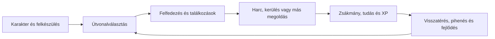

# Túlélők Földje ihletésű, böngészős fantasy RPG — első játékterv

Dátum: 2026. október 10. Cél: egyjátékos, magyar nyelvű játék, személyes használatra, böngészőben, telepítés nélkül.

**Megvalósítási állapot:** elkészült az első játszható expedíció 7 régióval, 9 választható származással, 4 induló úttal, harccal, 7 küldetéssel és mentéssel. A kipróbálás és a ténylegesen elkészült funkciók a [README-ben](../README.md) szerepelnek. Ez a dokumentum az eredeti, nagyobb léptékű tervet őrzi; a lentebb szereplő tartalmi célok nem mind készültek el az első kiadásban.

Ez az első tervezési változat. A felhasználó által feltöltött Wikipédia-szöveg alapján már ismerjük a TF néhány fontos jellemzőjét. Az elsődleges szabálykönyv, a tárgyadatok és a harci matematika kutatása még folyamatban van. Az alábbi számszerű rendszerek saját, tesztelendő javaslatok.

## A javasolt játék

Festett 2D világot javaslok, enyhén döntött felülnézettel és térbeli hatású épületekkel. A kis karakter ténylegesen mozog a tájon, az ellenfelek láthatók, a felszerelés és a varázslatok használhatók. A harc megállítható, így lehet átgondolt döntéseket hozni. A fő élmény a felkészülés, a felfedezés, a kockázat, a zsákmány és a fokozatosan megnyíló világ.

A látványkoncepció itt látható: [latvanykoncepcio.png](latvanykoncepcio.png). Ez a tervezett hangulatot és a képernyő szerkezetét mutatja. A ténylegesen játszható grafika csempékből, különálló tárgyakból és animált karakterekből készül majd; a koncepciókép nem használható egyben járható pályaként.

A teljes első tartalomváltozat tervezési célja **8–12 eltérő régió és 1–30. szintig tartó fejlődés**, további régiókkal bővíthetően. Ez még nem elkészült tartalom vagy játékidőígéret. A nagy világ értékét az eltérő helyzetek, történetek, ellenfélviselkedések és karakterépítések adják.

## Mit hozunk át a TF élményéből?

| A feltöltött TF-leírásból ismert elem | Mai játékbeli megfelelő | Eredet |
|---|---|---|
| Faj, név és külső választása; faji adottságok | Karakteralkotó, fajleírások, portré és induló előélet | Forrásból ismert elv, új felület |
| Véletlenül generált tulajdonságok | Választható kiegyensúlyozott pontelosztás; később külön nosztalgikus generálás | Saját átalakítás |
| Sorrendben végrehajtott, korlátos utasítássor | Opcionális expedíciós terv: útvonal → keresés → gyűjtés → visszatérés | Saját átalakítás |
| Szöveges kaland és csatabeszámoló | Olvasható kalandnapló a bejárt út, találatok, leletek és döntések összefoglalójával | Forrásból ismert élmény, új megoldás |
| Grafikus térkép, karakterlap, tárgylista | Felfedezési ködös világtérkép, részletes karakterlap és felszerelés | Forrásból ismert elv, új felület |
| Erő, fegyver és páncél hatása a harcra | Külön tesztelhető szabálymotor, látható támadási és védelmi értékek | Saját matematika, amíg nincs pontos elsődleges szabály |
| Világégés utáni félsziget, sokféle lény és isten | Felfedezhető fantasy világ, történetszálak és választható elköteleződés | Forrásból ismert háttér, részletes tartalom még kutatandó |
| Közösségek és közös célok | NPC-frakciók, mesterek, követők, visszatérő szereplők | Saját egyjátékos átalakítás |

A történeti kilencnapos postai fordulót az új játékban azonnali feldolgozás váltja fel. A tervezett lépések közben új veszély vagy fontos felfedezés megállítja a végrehajtást, és visszaadja az irányítást.

## Egy expedíció menete

Például a falu mesterétől megtudjuk, hogy egy őrtorony alatt régi rom van. Beszerzünk élelmet és egy fáklyát. Az erdőben megkerülhetjük a farkasokat, vagy nyersanyagért vállalhatunk egy harcot. A hídhoz vezető út biztonságosabb, a gázló gyorsabb, de úszástudást vagy más megoldást kíván. A rom bejáratát erővel, zárnyitással vagy rúnák megfejtésével nyithatjuk ki. A leletből új varázslat vagy felszerelés származik, amely egy következő helyen más lehetőséget ad.

Ez a példa saját küldetésötlet, nem a TF egy konkrét kalandjának állítása.

## Karakteralkotás

Első lépés a név, portré és megjelenés, majd a faj és az előélet. A feltöltött forrásban kilenc faj szerepel: **ember, elf, törpe, árnymanó, troll, gnóm, alakváltó, kobudera és mutáns**. A teljes tervezett karakterválaszték ebből indulhat ki; a számszerű bónuszokat csak az elsődleges szabályok megismerése után választjuk el az új rendszer bónuszaitól.

Az első működési próbában három, eltérő játékstílust támogató faj elegendő. Az alakváltó, a regeneráló troll és a pszi-képességekre épülő mutáns több speciális mechanikát és animációt kíván; ezek külön tartalmi bővítésként kerülnek be.

Hat saját tervezésű tulajdonság:

| Tulajdonság | Játékbeli szerep |
|---|---|
| Erő | Közelharci sebzés, teherbírás, fizikai akadályok |
| Ügyesség | Találati pontosság, kitérés, ügyességi próbák |
| Állóképesség | Életerő, terhelhetőség, mérgek elleni védelem |
| Ész | Mana, varázstanulás, rúnák és tárgyak felismerése |
| Bölcsesség | Észlelés, természetismeret, bizonyos mágikus és gyógyító hatások |
| Akarat | Koncentráció, félelem és mentális hatások elleni védelem |

Nem kötjük végleg kaszthoz a karaktert: harcos, vadász, mágus vagy vegyes karakter építhető a tanult képességekből és a felszerelésből. Az előélet induló eszközöket és történeti kapcsolódást ad. A játék később újraelosztható képességpontokat kínál, hogy egy kezdeti rossz választás miatt ne kelljen elveszíteni a már bejárt világot.

## Fejlődés és a világ veszélyei

XP jár a veszélyes ellenfelekért, az új helyekért és a küldetések többféle megoldásáért. Szintlépéskor tulajdonság- és képességpontot kapunk. Négy kombinálható kezdő ág: fegyverforgatás, vadászat/ügyesség, arkanikus mágia és természet/túlélés. A szakmai tudás — például főzés, alkímia vagy úszás — külön tanulható képesség; nem szükséges mindent szörnyöléssel megszerezni.

A szintlépéshez szükséges saját kezdőgörbe: `80 + 25L + 5L²` XP az `L` szintről a következőre. A növekvő költség miatt a későbbi fejlődést a nehezebb területek jutalmai és új történetek támogatják. A részletes számpéldák a [rendszertervben](rendszerterv.md) szerepelnek.

**A régió határozza meg a fő veszélyt.** A játékos fejlődésével új, nehezebb vidékeken vállalhat expedíciót; a kezdőterület farkasai továbbra is kezdő ellenfelek maradnak. Így érezhető az erősödés. Egy helyi esemény vagy járőr a régió saját sávján belül változhat.

| Területjavaslat | Jellemző szint | Új döntések |
|---|---:|---|
| Menedékfalvak és határerdő | 1–4 | Alapfelszerelés, útválasztás, első rom |
| Ködös erdő és elhagyott bánya | 4–8 | Mérgek, titkos ösvények, hosszabb expedíció |
| Mocsár és széttört fennsík | 8–13 | Ellenállások, terepveszély, összetett csapatok |
| Hegylánc és ősi város | 13–20 | Többlépcsős kazamaták, különleges anyagok |
| Átkozott határ és mélyvilág | 20–30 | Végjáték, összetett főellenfelek, történeti következmények |

Ezek saját régióötletek és veszélyszintek. A TF eredeti térképének feldolgozása külön kutatási feladat.

## Harc és mágia

A normál mozgás közvetlen: billentyűkkel vagy célpontra kattintással. A **szóköz aktív szünetet** kapcsol; ekkor lehet célpontot, varázslatot, gyógyítást és következő mozdulatot választani. A szimuláció ugyanazt a szabályt használja szünetes és folyamatos játékban.

Az ellenfelek viselkedése is számít: a farkasok bekerítenek, a távolsági ellenfél távolságot tart, a támogató társait erősíti, a nagy ellenfél támadása előre látható. A fegyvercsaládok külön szerepet kapnak; a hosszú lándzsa, gyors kard, páncél ellen hasznos buzogány és íj eltérő helyzetekben jó.

A saját kezdőképletben a fizikai sebzés a fegyverből, az erőből és a célpont páncéljából számolódik:

`sebzés = fegyversebzés × (1 + 0,02 × (erő − 10)) × 100 / (100 + páncél)`

Egy 12–18 sebzésű kard átlagban 15-öt sebez. 16-os erőnél ez 16,8; 40-es páncél ellen 12 HP marad. A találati esély és a kritikus találat külön kerül rá a számításra. Minden érték saját kezdeti javaslat; a végleges arányokat eltérő karakterekkel és csataszimulációval ellenőrizzük.

A varázslatok közé sebzés, gyógyítás, védelem, kontroll és felfedezést segítő mágia kerüljön. A költség mana, cselekvési idő és esetenként komponens. A fény, a természetérzékelés vagy a veszélyes terepen átjutást segítő varázslat a harcon kívül is értékes. A páncél, tűzellenállás és mentális védelem külön érték legyen.

## Tárgyak, leletek és túlélés

A világban felszerelés, pénz, receptek, élelem, gyógynövény, érc, varázslati komponens és történeti tárgy található. A forrás számít: érceket bányából, növényeket megfelelő tájról, egyedi ereklyét konkrét romból vagy főellenféltől szerzünk.

A felszerelésnek közönséges, jó minőségű, ritka és epikus változata lehet; egyedi tárgyak kézzel készített hatást és történeti eredetet kapnak. A ritkaság nem teszi automatikusan használhatóvá az itemet: egy ritka íj értékét a karakter építése is meghatározza. A tárgyak szinttartománya a régió és az ellenfél nehézségéhez kötődik.

A [rendszerterv](rendszerterv.md) különválasztja a tárgydobás esélyét és a már kidobott tárgy ritkaságát. Például 50% felszerelésdobás és ezen belül 1% epikus arány együtt **0,5% epikus felszerelést** jelent egy jogosult találkozáson. Ezek tesztelendő számok. Az első jelentős főellenfél biztos, hasznos jutalmat adjon; a fő történet előrehaladása ne múljon egy rendkívül ritka véletlen dobáson.

Az élelem és a pihenés az expedíció hossza miatt fontos. A menüben olvasással töltött valós idő nem fogyaszt készletet. Biztonságos fogadóban vagy táborban feltöltődünk, a vadonban a pihenésnek látható kockázata lehet. A főzés és az alkímia tervezhető alapanyagokból működik.

Alap nehézségen a halál után az utolsó mentés betölthető. A végleges halál későbbi választható mód lehet. A hosszú karakterfejlődéshez megbízható mentés és visszaállítás szükséges.

## A nagy világ szerkezete

A világ kézzel tervezett fontos helyszíneket és determinisztikusan generált köztes tájat használjon. Város, történeti rom, küldetés, főellenfél és jelentős útvonal kézi tartalom. Az erdő aljnövényzete, kisebb táborok és egyes erőforrások szabályozott generálással készülhetnek. A különböző régiók saját ellenféllistát, időjárást, látványt és történetet kapnak.

Új helyek ne kizárólag magasabb szinttel nyíljanak meg: úszás, mászás, megszerzett térkép, frakciókapcsolat vagy varázslat is adhat hozzáférést. A veszélyes helyet nyomok, NPC-figyelmeztetés és térképi jelzés előzze meg.

A karakter körüli szektorokat töltjük be, a távolabbi világot összefoglaló állapotként tartjuk nyilván. A tartós világ megjegyzi a kifosztott ládát, elintézett küldetést, megváltozott szereplőt és felfedezett területet. Bizonyos állatok és nyersanyagok visszatérhetnek, a történeti döntések és egyszeri jutalmak megmaradnak.

## Böngészős megvalósítás

Ajánlott alap: **Phaser 3 + TypeScript + Vite**, WebGL-megjelenítéssel és IndexedDB-mentéssel. A menük és a hozzáférhető szöveges felület HTML-rétegben is megvalósíthatók. A harci matematika, a zsákmány és a világállapot külön modul legyen; az animáció a szabálymotor eredményét jelenítse meg.

A játék első változatához nincs szükség fiókra, közös játékszerverre vagy fizetős háttérszolgáltatásra. A mentés több automatikus biztonsági pontot és fájlba exportálást/importálást kap. A böngésző tárhelye törölhető, ezért a letölthető mentés alapfunkció. Később offline gyorsítótár és PWA is készülhet.

A projekt pontos csomagverzióit a megvalósításkor rögzítjük lockfile-ban. Az ismételt telepítés akkor `npm ci`, a szükséges ellenőrzések pedig build, típusellenőrzés, szabálytesztek és valódi böngészős játékpróba lesznek. Jelenleg nincs alkalmazáskód vagy futtatható csomagmanifest, ezért ezek még nem végrehajtott ellenőrzések.

A [technikai terv](technikai-terv.md) részletesen tartalmazza a szektorbetöltést, a mentést, a fejlesztési fázisokat és a látványválasztások összehasonlítását.

## A megvalósítás sorrendje

| Fázis | Konkrét eredmény | Mikor tekinthető működőnek? |
|---|---|---|
| 1. Kutatás és szabályrögzítés | Elsődleges TF-források, eredetjelölt szabályok, saját képletek | Az ismert és az új szabályok elkülönülnek; a nyitott kérdések láthatók |
| 2. Látvány és irányítás | Kis erdei pálya, mozgó karakter, kamera és egy ellenfél | A karakter jól irányítható, a veszély és az út olvasható valódi böngészőben |
| 3. Teljes első expedíció | Karakteralkotó, falu, két vadonterület, kazamata, főellenfél, loot és fejlődés 1–5. szintig | A teljes út végigjátszható, a mentés után ugyanott és ugyanazzal az állapottal folytatható |
| 4. Világrendszer | Több összekapcsolt régió, szektorbetöltés, világidő, tartalmi eszközök | A hosszú út korlátos memóriával működik; szektorváltás nem dupláz szereplőt vagy tárgyat |
| 5. Mély tartalom | Új fajok, képességek, régiók, történetek, frakciók és egyedi tárgyak | Több karakterépítés életképes; az új terület új döntést és eltérő kihívást ad |
| 6. Tartós kiadás | Mentésmigráció, beállítások, frissítés, célgépes ellenőrzés | A frissítés megőrzi a karaktert; exportált mentés másik böngészőben betölthető |

Az első expedíció a teljes rendszer alapjainak próbája. A kért nagy RPG-hez az erre épülő régiók és tartalmi fázisok is hozzátartoznak.

## Jelenlegi állapot és következő lépés

- Elkészült az első játékterv, a saját számszerű rendszerterv, a technikai terv és a látványkoncepció.
- A feltöltött Wikipédia-szöveg feldolgozott; az élő oldalak és az elsődleges szabályok elérése még hálózati akadályba ütközik.
- A szükséges három webhely engedélyezése visszaigazoltan konfigurációtervezetbe került. Az alkalmazás és közzététel a környezet beállításainál szükséges.
- A felhőgép és a Git-hozzáférés működik. A játék telepítése, indítása és tesztjei a projekt megvalósítása után ellenőrizhetők.

A következő tervezési munka az elsődleges TF-szabályok beemelése és a saját rendszerrel való összevetése. Ezután az első, teljes expedíció megvalósítása adhat valós tapasztalatot a harc, a látvány és a fejlődés minőségéről.
